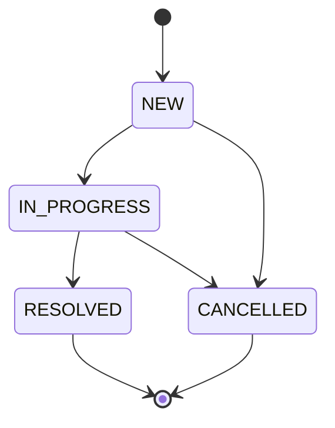
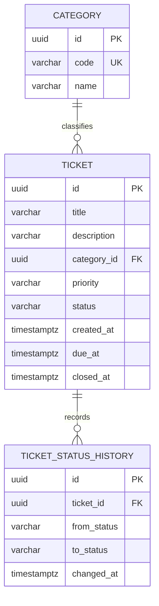

# Проектирование

## Зафиксированные версии

Версии выбраны до реализации и записаны в сборке и контейнерах.

| Инструмент | Версия |
| --- | --- |
| Java | 17 (Temurin) |
| Spring Boot | 3.5.16 |
| Kotlin | 1.9.25 |
| Gradle | 8.14.4, Wrapper |
| PostgreSQL | 16 |
| Flyway | 11.7.2, из BOM Spring Boot |
| JUnit Jupiter | 5.12.2, из BOM |
| Mockito | из `spring-boot-starter-test` |
| MockK | 1.13.17 |
| Testcontainers | 1.21.4 |
| springdoc-openapi | 2.8.16 |
| JaCoCo | версия плагина Gradle |
| Spotless | 6.25.0, Palantir Java Format и ktlint 1.3.1 |

На рабочей машине стоит JDK 17, поэтому язык приложения — 17, а не 21.

## Процесс заявки

Создание сразу пишет историю `null → NEW`. Закрытие и отмена заполняют `closed_at`. После этого заявку нельзя ни менять, ни вернуть в работу.

Просрочка не хранится в базе. Она вычисляется от текущего `Clock`: открытая заявка со сроком `dueAt <= now`.

## База данных

`V1` создаёт таблицы и ограничения. `V2` заполняет справочник категорий. `V3` добавляет индекс по заголовку. Индекс не меняет поведение старого кода, поэтому откат приложения на предыдущий образ остаётся возможным. Демонстрационные заявки лежат отдельно, в `db/demo`, и подключаются только профилем `docker`. Тесты их не видят.

Если в базе уже есть более новая аддитивная миграция, старый образ не падает: Flyway игнорирует отсутствующие локально миграции по шаблону `*:missing`. Удалять столбцы и переименовывать их в этой практике нельзя.

## Состав приложения

Java отвечает за заявки: контроллеры, JPA, правила статуса и просрочки, ошибки. Kotlin считает сводку. Java-контроллер `ReportController` вызывает Kotlin-сервис `ReportService`. Сервис получает строки через Java-интерфейс `TicketReportSource`, который реализует `TicketReportAdapter` поверх репозитория.

## Backlog

Оценки совпадают с распределением часов задания.

| ID | Приоритет | Часы | Результат |
| --- | --- | --- | --- |
| B-01 | Высокий | 6 | Спецификация, истории, критерии приёмки |
| B-02 | Высокий | 6 | Диаграммы, контракт API, каркас репозитория |
| B-03 | Высокий | 4 | Схема, миграции, справочник |
| B-04 | Высокий | 6 | Создание, чтение, проверка полей, ошибки |
| B-05 | Высокий | 4 | Статусы и история в одной транзакции |
| B-06 | Средний | 4 | Список, фильтры, страницы, категории |
| B-07 | Высокий | 10 | Сводка на Kotlin и вызов из Java |
| B-08 | Высокий | 12 | Автотесты, тест-план, дефекты |
| B-09 | Средний | 8 | Docker Compose, health check, копия базы |
| B-10 | Средний | 8 | Pipeline, стенд, откат образа |
| B-11 | Низкий | 4 | Инструкция и отчёт |
| | | 72 | |
